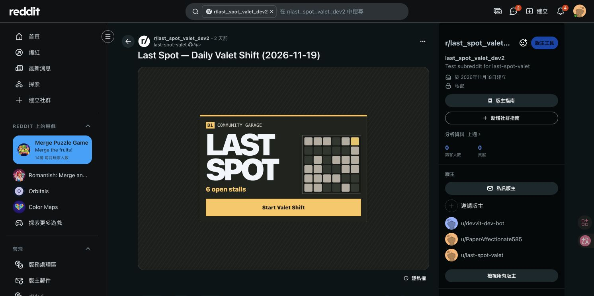
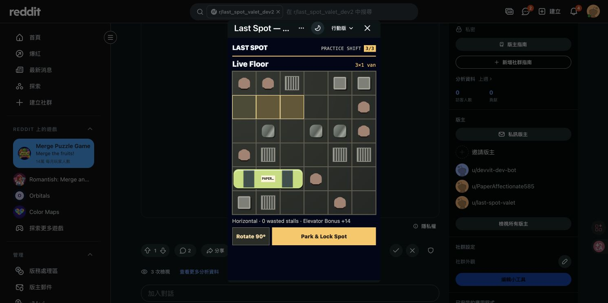
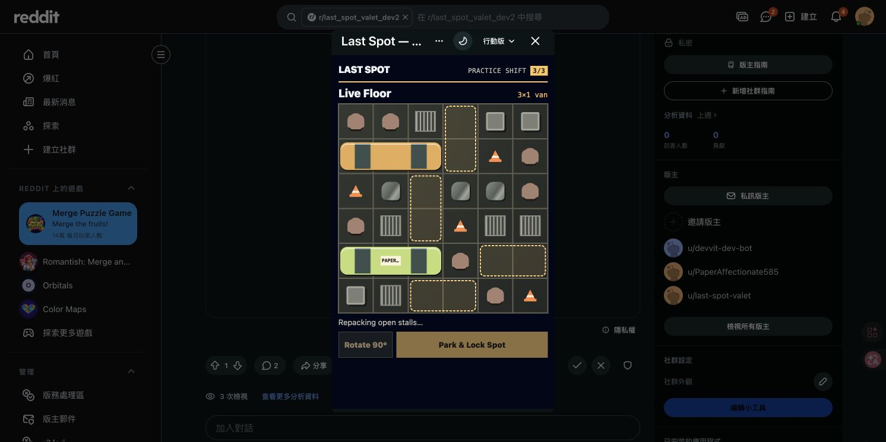
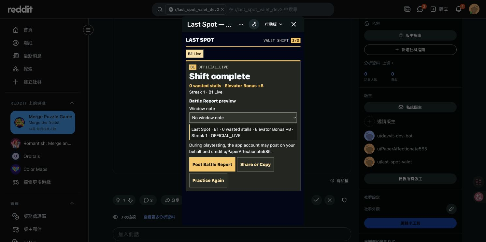
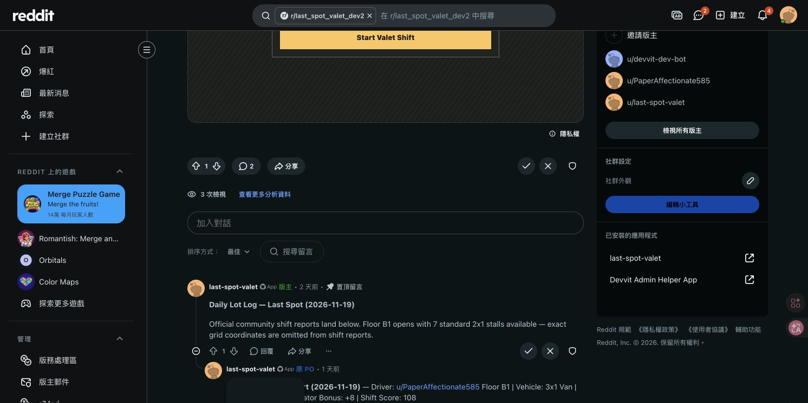

# Last Spot — Daily Valet Shift (Devpost Submission)

## Project Overview

- **Project Name**: `Last Spot`
- **Tagline (<= 60 chars)**: `Daily shared valet puzzle: park tight, leave stalls alive.`
- **Built With**: `devvit-web`, `typescript`, `react`, `tailwindcss`, `hono`, `redis`, `vite`, `vitest`, `fast-check`
- **App Listing (Unpublished Playtest Build)**: `https://developers.reddit.com/apps/last-spot-valet`
- **Test Subreddit (`< 200` members, private with `Devvit Admin Helper App` / `dr-admin-approve` installed)**: `https://www.reddit.com/r/last_spot_valet_dev2/`
- **Live Playable Demo Post**: `https://www.reddit.com/r/last_spot_valet_dev2/comments/1xzuxpw/last_spot_daily_valet_shift_20261119/`
- **Public Repository**: `https://github.com/GGGODLIN/reddit-last-spot`
- **License**: `Apache-2.0` (`https://github.com/GGGODLIN/reddit-last-spot/blob/main/LICENSE`)
- **Is this a port of an existing game?**: `No` (100% original game built from scratch during the November 11 – December 8, 2026 submission window; initial commit `288635e` on `2026-11-17`).

---

## Story (Devpost Project Details)

### Inspiration

Most daily puzzle games on the web are solitary experiences with a detached leaderboard bolted on afterward. You solve the same grid in isolation, compare a number in the comments, and your move never changes the world for anyone else.

We wanted a daily game that feels **native to a subreddit**: short enough to finish in 30–45 seconds right inside a feed post, easy to learn without a tutorial wall, and genuinely **shared**—where every player's daily decision leaves a permanent physical mark on the community's garage floor for the next Redditor who arrives.

### What it does

**Last Spot** turns every daily Reddit post into a shared underground parking garage floor (`6x6` mobile-safe grid, pre-seeded at 50–70% obstacle density with `6–10` open standard `2x1` stalls):

1. **Zero-Friction Feed `Splash` Preview (`splash.html`)**: Renders the live floor badge (`B1`), real-time stall occupancy thumbnail, remaining standard-stall count, and a single **Start Valet Shift** button straight from `context.postData` with **zero `/api/*` requests on mount** and full `touch-action: pan-y` feed scroll safety.
2. **Guided 3-Step Valet Shift (`game.tsx`)**:
   - **Warm-Up Bay 1 (`2x1` Sedan)** & **Warm-Up Bay 2 (`3x1` Van)**: Two rapid, deterministic 10–15 second solo bays teach spatial intuition around **Wasted Stalls** before the player touches the shared community floor.
   - **Step 3 — Shared `Live Floor` Official Lock**: Tap any open cell (`>= 44x44px` touch targets, zero internal scrollbars even at `288px` mobile width) to preview, tap again or press **Rotate 90°** to flip orientation, and press **Park & Lock Spot** to commit your vehicle onto the subreddit's live floor with your callsign plate and optional preset window note.
3. **Exact Capacity Math Made Visual (Ghost-Stall Repack)**: Under the hood, a zero-dependency `Int32Array` augmenting-path bipartite matching solver computes the exact remaining `2x1` domino capacity `ν(G)` in `< 0.1 ms`. Immediately after locking a spot, a `0.8s` **Ghost-Stall Repack** overlay highlights surviving stalls in dashed frames and drops orange hazard cones onto newly stranded **Dead Spots**—explaining the player's **Wasted Stalls** score visually without a single equation.
4. **Elevator Bonus, Last Spot Hero & Overflow Floors (`B1 [Full] / B2 [Live]`)**: Zero-waste placements earn a Manhattan-distance **Elevator Bonus** (`+2` per step saved toward `ELEV`). Whoever claims the final surviving stall (`ν(G') === 0`) is crowned **Last Spot Hero**, sealing `B1` as a browsable archive floor and atomically opening `B2` (up to `50` floors) inside the same Redis transaction so latecomers and judges always have a live floor to play.
5. **Logged-Out `VISITOR_HOLD` Handoff**: Logged-out visitors and judges can play all three steps against the real Live Floor snapshot, inspect their full score card, and click **Sign in to Lock Spot** to persist their chosen spot across `showLoginPrompt()` reload.
6. **Spoiler-Safe Stickied Battle Reports**: Players preview a coordinate-free Shift Report and post it as a reply under the post's single stickied **Daily Lot Log** comment (`hSetNX`-deduplicated with automatic rate-limit fallback), keeping the comment section lively without spoiling optimal coordinates or spamming top-level threads.

### How we built it

- **Platform**: [Reddit Devvit Web v0.15](https://developers.reddit.com/docs/capabilities/devvit-web/devvit_web_overview) (`@devvit/web@0.15.3`), React 19, Tailwind CSS 4, Hono serverless API, and Devvit Redis.
- **Zero-SDK Pure Domain Core (`src/shared/domain/`)**: Seeded garage generation (`seedrandom`), exact bipartite `2x1` capacity solver (`Int32Array`), waste/elevator scoring, and UTC calendar-deduplicated streaks run identically in both Hono serverless endpoints and React client previews.
- **Post-Scoped Optimistic Concurrency (`src/server/lib/redis-tx.ts` & `lot-store.ts`)**: All mutable state is isolated under four keys per post (`s1:post:{postId}:{meta,floors,placements,lb}`) with `< 256` byte `postData` summaries, 5-second non-personalized `/api/lot-summary` caching, `nx`-locked daily cron post creation (`00:00 UTC`), and atomic `watch` / `multi` / `exec` conflict handling (`409 SPOT_TAKEN` vs `409 LOT_UPDATED_RETRY_PREVIEW`).
- **Devvit Journeys Analytics & Moderator Ops**: Express-free Hono adapter for [Devvit Journeys](https://developers.reddit.com/docs/capabilities/analytics/devvit-journeys) (`/api/telemetry/journey`) plus moderator menu actions (`Create Last Spot Post`, `Last Spot Ops Health`, `Reset Last Spot Lot`, and `Probe Redis Transaction`) emitting structured JSON receipts (`ops.health_receipt`).
- **100% Local Assets & Devvit Rules Compliance**: Every SVG vehicle silhouette, parking texture, and font stack is bundled locally with zero external CDNs, zero third-party network calls, and zero Reddit/Snoo trademark usage.

### Challenges we ran into

- **`@devvit/redis@0.15.3` Transaction Semantics**: Discovering that `TxClient.get()` returns `this` (chainable builder) rather than a value and `TxClient.exec()` returns an empty array `[]` (not `null`) on watched-key contention. We built a dedicated `runAtomicRedisTransaction` wrapper with pre-`multi` reads, `try/finally` `unwatch()` + `discard()` slot-leak prevention (staying well inside Devvit's 20-slot limit), monotonic integer `revision` checks, and a live subreddit moderator probe (`Probe Redis Transaction`) that verified conflict interception on real Reddit Redis.
- **Express-Free Journeys Integration**: Wiring Devvit Journeys cleanly into a lightweight Hono server without pulling Express into the bundle, verified by an automated server-bundle test.
- **Mobile Feed Ergonomics**: Making a `6x6` spatial puzzle crisp, readable, and fat-finger-safe at `288px` mobile width without internal scrollbars or feed scroll hijacking.

### Accomplishments that we're proud of

- **Verified End-to-End on Live Hosted Reddit**: Automated `00:00 UTC` daily post creation, stickied `Daily Lot Log` comment pinning, Redis optimistic-lock contention handling, 3-step live vehicle locking with inline Splash feed updates, spoiler-free Battle Report replies, and `ops.health_receipt` (`ok: true`, `matchInvariantOk: true`) all verified directly on `r/last_spot_valet_dev2` with zero local playtest servers.
- **Property-Based Correctness (`P1..P5`)**: `26/26` automated Vitest + `fast-check` tests checking our `Int32Array` bipartite matcher against an independent recursive backtracking oracle across randomized grids, alongside UI, concurrency conflict, and route-bijection tests.

### What's next for Last Spot

- After hackathon judging concludes, submit **Last Spot** to Reddit App Review so any subreddit can install daily shared valet shifts with custom community vehicle themes and weekly Hero flairs.

---

## Judge Testing Instructions

1. Open the live Demo Post in our `< 200`-member private playtest subreddit (`Devvit Admin Helper App` / `dr-admin-approve` installed for automatic admin access):
   `https://www.reddit.com/r/last_spot_valet_dev2/comments/1xzuxpw/last_spot_daily_valet_shift_20261119/`
2. On the inline feed card (`Splash`), observe the current floor (`B1`), live stall count, and tap **Start Valet Shift**.
3. Complete **Warm-Up Bay 1** (`2x1` Sedan) and **Warm-Up Bay 2** (`3x1` Van) by tapping an open stall, optionally rotating `90°`, and confirming.
4. On **Step 3 — Live Floor**, park your daily vehicle onto the shared community garage, watch the **Ghost-Stall Repack** overlay highlight surviving stalls and any Dead Spots, and inspect your Shift Score + Elevator Bonus.
5. *(Logged-in Reddit account)* Tap **Post Battle Report** to preview and post a spoiler-free shift card under the stickied **Daily Lot Log** comment. *(Logged-out account)* Inspect the full `VISITOR_HOLD` flow and **Sign in to Lock Spot** handoff.
6. Close the modal to see the inline feed `Splash` card immediately reflect the newly parked vehicle and updated open stall count.

---

## Gallery Screenshots (Live Hosted on Reddit)

- 
- 
- 
- 
- 
